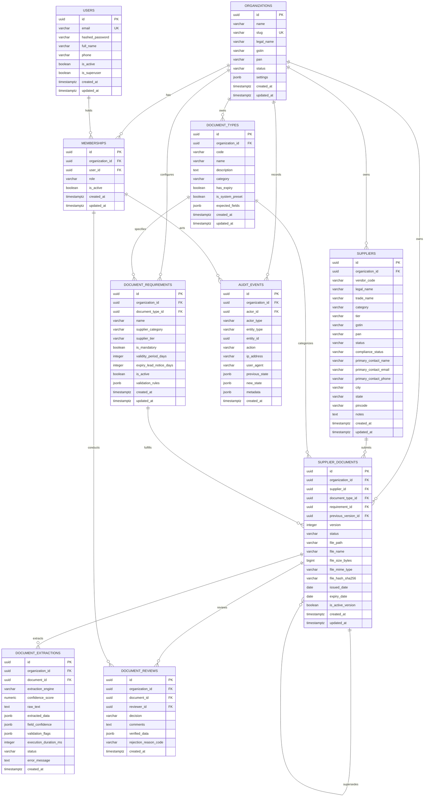

# VendorFlow AI: System Architecture & Data Isolation

## 1. System Architecture Overview

VendorFlow AI is a B2B SaaS platform designed specifically for Indian manufacturing enterprises. Its primary purpose is to streamline supplier onboarding, document collection, automated AI/OCR extraction and cross-validation, compliance tracking, and auditable approval workflows.

The system is architected as an asynchronous, document-first web platform emphasizing strict multi-tenant isolation, verifiable audit trails, and modular domain separation.

### High-Level Topology

```
+-----------------------------------------------------------------------+
|                           Client Layer                                |
|   Next.js 16 (React 19, TypeScript, Tailwind CSS v4, Lucide Icons)     |
|   - Internal Buyer Dashboard & Review Workspace                       |
|   - Supplier Onboarding & Document Submission Portal                  |
+-----------------------------------+-----------------------------------+
                                    | HTTPS / JSON REST API
                                    v
+-----------------------------------------------------------------------+
|                           API Service Layer                           |
|   FastAPI (Python 3.12, Uvicorn, Pydantic v2 Settings & Schemas)       |
|   - Authentication & Organization Context Resolution Middleware       |
|   - Tenant-Scoped Route Handlers & Dependency Injection               |
|   - File Signature (Magic Bytes) & Upload Staging Pipelines           |
|   - Async Local AI/OCR Extraction Workers                             |
|   - Compliance Calculation Engine                                     |
+-----------------------------------+-----------------------------------+
                                    | SQLAlchemy 2.0 Async (asyncpg)
                                    v
+-----------------------------------+-----------------------------------+
|                           Data Layer                                  |
|   PostgreSQL 17 (Docker Compose)                                      |
|   - Tenant-Scoped Relational Tables                                   |
|   - Composite Foreign Keys for Structural Referential Tenant Integrity|
|   - Reviewer & Actor Membership Integrity Enforcement                 |
|   - Document Requirement & Type Consistency Constraints               |
|   - JSONB Storage for OCR Payloads & Human Verification Overrides     |
|   - Append-Only Audit Event Ledger (with DB Permission Separation)    |
|                                                                       |
|   Local Filesystem Storage (`storage/documents/<org_id>/...`)         |
|   - UUID-Addressed Document Files with SHA-256 Integrity Verification |
+-----------------------------------------------------------------------+
```

---

## 2. Multi-Tenant Architecture & Data Isolation

### 2.1 The Tenant Unit

In VendorFlow AI, an **Organization** (`organizations`) represents a single manufacturing buyer (tenant). All operational data—including suppliers, document requirements, uploaded files, extraction results, reviews, and audit events—is strictly isolated by `organization_id`.

A user can belong to one or more organizations via the `memberships` table, with role-based permissions (`owner`, `admin`, `reviewer`, `viewer`).

### 2.2 Supplier Data Model Decision: Option A vs Option B

A foundational architectural decision is how supplier records are modeled across tenants:

- **Option A (Tenant-Scoped Supplier Records - Selected)**: Each buyer organization owns an independent `suppliers` record. If Supplier X serves Buyer A and Buyer B, separate supplier records exist in Buyer A's and Buyer B's tenant partitions.
- **Option B (Shared Global Supplier Identity - Rejected)**: Suppliers exist as global entities, and buyers establish many-to-many relationship links.

#### Architectural Rationale for Option A:
1. **Zero Risk of Cross-Tenant Data Contamination**: In manufacturing supply chains, supplier vendor codes, payment terms, internal risk tiers, and bilateral compliance agreements are strictly confidential proprietary information. Option A eliminates accidental cross-tenant data leaks.
2. **Confidentiality of Buyer-Supplier Relationships**: Option B risks leaking competitor supply chain intelligence (e.g. competitors discovering shared component suppliers or vendor onboarding volumes). Option A ensures complete opacity between buyers.
3. **Bilateral Document Nature in Indian Manufacturing**: Compliance documents (e.g. bank mandates, non-disclosure agreements, buyer-specific vendor codes, and tailored quality declarations) are explicitly issued to a specific buyer. A shared global document repository is neither legally appropriate nor accepted by enterprise procurement teams.
4. **Clean Structural Database Constraints**: Option A allows every subordinate table to enforce tenant boundaries using composite foreign keys `(id, organization_id)`.

### 2.3 Document Type Ownership: Tenant-Owned Preset Copies

To guarantee referential integrity and eliminate tenant-isolation leaks:
- System preset document types (`gst_certificate`, `pan_card`, `msme_udyam`, `bank_mandate`, `iso_9001`, `factory_license`) are initialized as **tenant-owned copies** (`is_system_preset = TRUE`) when an organization is created.
- `document_types.organization_id` is strictly `NOT NULL`.
- Both `document_requirements` and `supplier_documents` reference `document_types(id, organization_id)` using composite foreign keys, guaranteeing that a buyer's requirements and documents can never reference another tenant's custom or preset document types.

---

## 3. Tenant Isolation Strategy

VendorFlow AI employs a **defense-in-depth** strategy combining application-level scoping with database-level composite foreign key constraints.

```
Request with Dev Headers / Bearer Token
              │
              ▼
┌──────────────────────────────────────────────┐
│  FastAPI Dependency:                         │
│  `get_organization_context`                  │
│  - Delegates to `IdentityProvider` protocol  │
│  - Resolves & verifies user & active status  │
│  - Resolves & verifies organization status   │
│  - Verifies active tenant membership         │
│  - Returns immutable `OrganizationContext`   │
│  - Optional `require_roles(...)` enforcement │
└──────────────────────┬───────────────────────┘
                       │
                       ▼
┌──────────────────────────────────────────────┐
│  SQLAlchemy Async Session                    │
│  - Every query forces:                       │
│    `WHERE organization_id = :tenant_id`      │
│  - Every INSERT populates `organization_id`  │
└──────────────────────┬───────────────────────┘
                       │
                       ▼
┌──────────────────────────────────────────────┐
│  PostgreSQL 17 Database Engine               │
│  - Composite Foreign Keys:                   │
│    `FOREIGN KEY (supplier_id, org_id)`       │
│    `REFERENCES suppliers (id, org_id)`       │
│  - Requirement & Document Type Consistency:  │
│    `FOREIGN KEY (req_id, type_id, org_id)`   │
│    `REFERENCES doc_requirements(...)`        │
│  - Membership Existence Integrity:           │
│    `FOREIGN KEY (reviewer_id, org_id)`       │
│    `REFERENCES memberships (user_id, org_id)`│
│  - Hard physical rejection of mismatched     │
│    tenant IDs across tables                  │
└──────────────────────────────────────────────┘
```

### 3.1 Application-Level Tenant Scoping vs Database Guarantees

It is critical to distinguish what the database enforces from what the application layer must guarantee:

- **What Composite FKs Enforce**:
  1. Prevents cross-tenant relational links (e.g. Document of Tenant A referencing Supplier of Tenant B).
  2. Prevents type/requirement mismatches (e.g. Document of Type A referencing Requirement of Type B).
  3. Enforces membership existence (e.g. Reviewer or Actor must have a record in `memberships(user_id, organization_id)`).
- **What Application Authorization Must Enforce**:
  1. Composite FKs do NOT prevent an authenticated user of Tenant A from executing an un-scoped `SELECT * FROM suppliers` if application code omits `WHERE organization_id = :tenant_id`. Every repository query must enforce tenant filtering.
  2. The database checks membership *existence*, not whether `memberships.is_active` is currently TRUE, whether `users.is_active` is TRUE, or whether the user holds the requisite role (`reviewer`, `admin`, `owner`). These active checks are mandatory application-level middleware responsibilities.
  3. Row-Level Security (RLS) offers additional database-level query isolation; deferred for MVP due to `asyncpg` connection pooling session leakage risks, but preserved as an architectural option for future hardening.

### 3.2 OrganizationContext & Authorization Abstraction

FastAPI routes interact with an immutable request-scoped context:
- **`OrganizationContext`**: Contains `user_id`, `organization_id`, `membership_id`, `role`, `user_email`, `user_full_name`, `is_superuser`, `organization_name`, `organization_slug`.
- **Dependencies**:
  - `get_organization_context`: Injects validated tenant context into endpoints.
  - `require_roles(*roles)`: Enforces role-based permissions (`owner`, `admin`, `reviewer`, `viewer`).
  - `require_admin_or_owner`: Shortcut for administrative operations.
  - `require_reviewer`: Shortcut for review operations.

### 3.3 Replaceable Identity Provider Architecture

The identity resolution layer decouples tenant context resolution from authentication mechanisms:
- **`IdentityProvider` Protocol**:
  ```python
  class IdentityProvider(Protocol):
      async def resolve_context(self, request: Request, db: AsyncSession) -> OrganizationContext: ...
  ```
- **`DevIdentityProvider`**: Development and testing implementation using explicit headers (`X-Dev-User-Id`, `X-Dev-Organization-Id` / `X-Organization-Slug`). Never accepts client headers without database membership verification. Rejects missing, inactive, or cross-tenant identities.
- **Production Integration Boundary**: In production environments, a cryptographic token provider (JWT / OIDC / OAuth2) will replace `DevIdentityProvider` by overriding `get_identity_provider`, requiring zero changes to domain services or endpoints.

### 3.4 Database Composite Foreign Key Constraints

1. `suppliers` defines a unique constraint on `(id, organization_id)`.
2. `document_requirements` defines `UNIQUE (id, document_type_id, organization_id)`.
3. `supplier_documents` defines composite foreign keys to:
   - `suppliers(id, organization_id)`
   - `document_types(id, organization_id)`
   - `document_requirements(id, document_type_id, organization_id)`
   - `supplier_documents(id, organization_id)` (version ancestry via `previous_version_id`)
4. `document_reviews` and `audit_events` reference `memberships(user_id, organization_id)`:
   ```sql
   FOREIGN KEY (reviewer_id, organization_id)
       REFERENCES memberships(user_id, organization_id)
       ON DELETE RESTRICT;

   FOREIGN KEY (actor_id, organization_id)
       REFERENCES memberships(user_id, organization_id)
       ON DELETE RESTRICT;
   ```

---

## 4. Entity-Relationship Model



---

## 5. Domain Architecture & Core Workflows

### 5.1 Identity & Organization Domain
- **Multi-Tenant Memberships**: Users authenticate globally, while permissions (`owner`, `admin`, `reviewer`, `viewer`) are established per organization.
- **Slugs for Workspace Routing**: Organizations have URL-safe unique slugs (e.g. `/workspace/acme-auto/suppliers`).
- **Timestamp Maintenance**: All `updated_at` columns are maintained by database-level `BEFORE UPDATE` trigger functions and SQLAlchemy `onupdate=func.now()`.

### 5.2 Supplier Domain Service & Repository Architecture

The Supplier domain (`apps/api/app/api/routes/suppliers.py`, `app/services/supplier.py`, `app/repositories/supplier.py`) models the core buyer-supplier lifecycle within a tenant organization.

```
                          HTTP Request
                               │
                               ▼
            ┌──────────────────────────────────────┐
            │  FastAPI Router: /api/v1/suppliers   │
            │  - Resolves OrganizationContext      │
            │  - Validates schemas (extra=forbid)  │
            └──────────────────┬───────────────────┘
                               │
                               ▼
            ┌──────────────────────────────────────┐
            │  SupplierService                     │
            │  - Tenant business validation        │
            │  - Uniqueness pre-checks (409)       │
            │  - Status & archival transitions     │
            │  - Emits AuditEvent in-transaction   │
            │  - Orchestrates commit / rollback    │
            └──────────────────┬───────────────────┘
                               │
                               ▼
            ┌──────────────────────────────────────┐
            │  SupplierRepository                  │
            │  - All queries strictly scoped by    │
            │    `Supplier.organization_id == ctx` │
            │  - Filtered & paginated queries      │
            │  - Direct SQLAlchemy ORM operations  │
            └──────────────────┬───────────────────┘
                               │
                               ▼
            ┌──────────────────────────────────────┐
            │  PostgreSQL 17 Database              │
            │  - suppliers table                   │
            │  - audit_events table                │
            └──────────────────────────────────────┘
```

#### Layer Responsibilities
1. **API Router Layer (`api/routes/suppliers.py`)**:
   - Injects `OrganizationContext` via `Depends(get_organization_context)` and `AsyncSession` via `Depends(get_db)`.
   - Delegates business orchestration to `SupplierService`.
   - Maps responses to Pydantic schemas (`SupplierResponse`, `SupplierListResponse`).
   - Ensures client cannot inject or tamper with `organization_id` by enforcing `ConfigDict(extra="forbid")` on `SupplierCreate` and `SupplierUpdate`.

2. **Domain Service Layer (`services/supplier.py`)**:
   - Enforces business validation rules and tenant-scoped uniqueness (`vendor_code`, `gstin`).
   - Manages state transitions: protects archived suppliers against updates (HTTP 400), soft-archives active suppliers, and rejects repeated archival (HTTP 400).
   - Manages transactional boundaries: commits supplier entity changes and corresponding `AuditEvent` records (`supplier.created`, `supplier.updated`, `supplier.archived`) in the exact same database transaction.
   - On error or conflict, rolls back the transaction entirely so no orphaned business records or audit events persist.

3. **Persistence Repository Layer (`repositories/supplier.py`)**:
   - Encapsulates all SQLAlchemy queries for the `Supplier` entity.
   - Every read and write query unconditionally appends `Supplier.organization_id == organization_id`.
   - Supports paginated listings with filtering by `status` and case-insensitive substring search across `legal_name`, `trade_name`, `vendor_code`, `gstin`, and `pan`.
   - Computes exact total counts within the tenant's filtered subset for pagination metadata.

#### Archival Lifecycle Semantics
In compliance with Indian statutory requirements (Companies Act 2013 and CGST Act 2017), supplier records are never permanently hard-deleted from the database:
- Archival transitions `status` to `'archived'`.
- Archived records remain accessible to authorized reviewers for historical audits and compliance inspections.
- Archived suppliers are immutable: any subsequent update attempt is rejected with HTTP 400 Bad Request.
- Archival is idempotent-safe: attempting to archive an already-archived supplier is rejected with HTTP 400 Bad Request.

### 5.3 Document Catalog & Organization-Specific Requirements Architecture

The Document Requirements domain (`apps/api/app/api/routes/document_types.py`, `document_requirements.py`, `app/services/`, `app/repositories/`) enables each buyer organization to establish and customize its document compliance policy matrix.

```
                          Client HTTP Request
                                   │
                                   ▼
            ┌──────────────────────────────────────────────┐
            │  FastAPI Routers:                            │
            │  - /api/v1/document-types                    │
            │  - /api/v1/document-requirements             │
            │  - /api/v1/suppliers/{id}/document-requirements│
            │  Enforces OrganizationContext injection      │
            └──────────────────────┬───────────────────────┘
                                   │
                                   ▼
            ┌──────────────────────────────────────────────┐
            │  Domain Services:                            │
            │  - DocumentTypeService                       │
            │  - DocumentRequirementService                │
            │  Validates tenant boundaries, duplicates     │
            │  Orchestrates in-transaction AuditEvents     │
            └──────────────────────┬───────────────────────┘
                                   │
                                   ▼
            ┌──────────────────────────────────────────────┐
            │  Repositories:                               │
            │  - DocumentTypeRepository                    │
            │  - DocumentRequirementRepository             │
            │  Strictly scopes all queries by org_id       │
            └──────────────────────┬───────────────────────┘
                                   │
                                   ▼
            ┌──────────────────────────────────────────────┐
            │  PostgreSQL 17 Database                      │
            │  - document_types (composite unique code)    │
            │  - document_requirements (composite FK)      │
            │  - audit_events                              │
            └──────────────────────────────────────────────┘
```

#### Key Architecture Principles:
1. **Tenant-Scoped Document Catalog**:
   - `document_types` are strictly owned by each organization.
   - Unique code constraint `(organization_id, code)` prevents duplicate codes within a tenant while allowing independent organizations to use standard codes (`gst_certificate`, `pan_card`, `iso_9001`).
2. **Referential Tenant Boundary Guarantee**:
   - `document_requirements` enforces foreign key `(document_type_id, organization_id) REFERENCES document_types(id, organization_id) ON DELETE RESTRICT`.
   - The service layer actively verifies that `document_type_id` belongs to `OrganizationContext.organization_id` prior to database execution, returning `400 Bad Request` instead of leaking database foreign key violation details.
3. **Requirement Mapping Uniqueness**:
   - An organization cannot define ambiguous duplicate requirements for the exact same `(document_type_id, supplier_category, supplier_tier)`. Duplicate requests return `409 Conflict`.
4. **Supplier Requirement Evaluation Engine**:
   - Evaluates requirements applicable to a specific supplier based on the supplier's `category` and `tier`.
   - Filters out disabled requirements (`is_active == FALSE`).
   - Resolves requirements where `supplier_category IS NULL OR supplier_category == supplier.category` and `supplier_tier IS NULL OR supplier_tier == supplier.tier`.
   - Cleanly partitions results into `mandatory_requirements` and `optional_requirements`.
   - Cross-tenant supplier evaluation attempts are strictly rejected with `404 Not Found`.

### 5.4 Configurable Indian Regulatory Compliance Engine
VendorFlow AI does **not** hardcode Indian compliance rules into table definitions or database enums:
- System preset `document_types` are seeded per organization (`is_system_preset = TRUE`).
- Organizations can create custom document types (`is_system_preset = FALSE`).
- `document_requirements` define dynamic requirement matrices per buyer, filtered by `supplier_category` and `supplier_tier`.
- JSONB `validation_rules` define regex patterns, cross-document checks, and mandatory fields without requiring database schema changes when statutory regulations evolve.

### 5.4 Document Versioning & Resubmission Lifecycle
- **Separation of Version Activity from Outcome**:
  - A rejected document permanently retains `status = 'rejected'`.
  - An expired document permanently retains `status = 'expired'`.
  - A document requiring supplier correction retains `status = 'action_required'`.
  - Terminal outcomes are **never overwritten** with `'superseded'`.
  - When replacement version $N+1$ is submitted:
    - Version $N$'s `is_active_version` becomes `FALSE`.
    - Version $N+1$'s `previous_version_id` points to Version $N$.
    - Version $N+1$'s `is_active_version` becomes `TRUE`, with `status = 'uploaded'`.
- **MVP Active Document Rule**:
  - The MVP enforces at most **one active document per supplier and document type** via a partial unique index.
- **Review and Verification Transitions**:
  - Review decision `approved` transitions `supplier_documents.status` to `'verified'`.
  - Review decision `rejected` transitions `supplier_documents.status` to `'rejected'`.
  - Review decision `revision_requested` transitions `supplier_documents.status` to `'action_required'`.
  - Human-verified dates (`issued_date`, `expiry_date`) and confirmed fields are populated from `document_reviews.verified_data`.
  - Automated cross-document checks in `document_extractions.validation_flags` highlight warnings for human reviewers, but do NOT automatically hard-block reviewer approval.
- **Application-Level Expiry & Compliance Evaluation**:
  - Documents are NOT automatically deactivated merely because their `expiry_date` is in the past. Expiry and compliance evaluation belong to the compliance calculation service or scheduled background tasks, avoiding silent database-level mutations.

### 5.5 Database-Level `updated_at` Triggers
To guarantee timestamp accuracy across all direct update mechanisms (Alembic scripts, maintenance SQL, and ORM operations), PostgreSQL triggers are bound to all seven tables with `updated_at`:
- `set_updated_at_column()` function sets `NEW.updated_at = NOW()` `BEFORE UPDATE`.
- Bound to `organizations`, `users`, `memberships`, `suppliers`, `document_types`, `document_requirements`, and `supplier_documents`.
- Append-only tables (`document_extractions`, `document_reviews`, `audit_events`) omit `updated_at` and triggers.

### 5.6 Document Storage Pattern & Upload Lifecycle
- **Filesystem Storage**: Document files are stored on the local filesystem under UUID paths:
  `storage/documents/<org_id>/<supplier_id>/<document_id>.<ext>`.
- **File Signature (Magic Bytes) Inspection**: Upload processing inspects binary magic bytes (`%PDF-`, `\xFF\xD8\xFF`, `\x89PNG\r\n\x1a\n`) rather than trusting the client-supplied `Content-Type` header.
- **SHA-256 Role**: Used strictly as an **integrity verification and duplicate-detection mechanism**, not as content-addressed storage.
- **Upload Lifecycle**:
  1. Staged in temporary quarantine (`storage/tmp/...`).
  2. Magic bytes validated, size checked, SHA-256 hashed.
  3. Atomically moved to permanent UUID path.
  4. Committed to database in transaction.
  5. Failed uploads unlinked immediately; periodic background job prunes orphaned files.

---

## 6. Audit Integrity & Permissions Architecture

### 6.1 Honest Audit Posture
A standard relational table is not cryptographically tamper-proof by default. VendorFlow AI implements a practical defense-in-depth model:
1. **Application-Level Immutability**: The SQLAlchemy models and API layer expose only `INSERT` and `SELECT` on `audit_events`. No `UPDATE` or `DELETE` endpoints or queries are implemented.
2. **Production Database-Level Privilege Separation**: In production, two distinct database roles are established (via `infra/scripts/01_provision_roles.sql`):
   - `vendorflow_admin`: Schema owner and migration executor with full DDL.
   - `vendorflow_app`: Least-privilege runtime connection pool user. Holds `SELECT, INSERT` on `audit_events`, while `UPDATE`, `DELETE`, and `TRUNCATE` are explicitly revoked.
   - *Limitation*: In PostgreSQL, table owners and superusers bypass `GRANT`/`REVOKE`. Thus, engine-enforced audit immutability strictly requires the app to connect as a non-owner (`vendorflow_app`). In local dev, the single `vendorflow` superuser operates under application-enforced immutability.
3. **Actor Attribution & Membership Scoping**: All user-initiated events enforce that `actor_id` references an existing membership in that organization. System events have `actor_id = NULL`.
4. **Polymorphic Target Validation**: `entity_id` references multiple entity tables; referential existence and tenant ownership are validated at the application layer before event creation.

### 6.2 Test Database Isolation & Safety Architecture
- **Dedicated Test Database**: Integration tests and migration checks run strictly against `vendorflow_test`.
- **Environment Isolation**: `TEST_DATABASE_URL` separates test execution from the development database `vendorflow`.
- **Safety Assertion**: Code-level guard in `Settings.get_test_database_url()` rejects any target database whose name is not strictly `vendorflow_test`.
- **Zero Fallback**: Missing test database configuration raises explicit configuration errors rather than falling back to development or production databases.

---

## 7. Retention & Archival Policies (Compliance Lifecycle)

VendorFlow AI avoids blanket claims of universal 8-year retention. Statutory requirements differ by record type:

1. **Companies Act, 2013 - Section 128(5)**: Books of account and related vouchers/papers must be kept in good order for not less than **eight financial years** preceding the current year.
2. **CGST Act, 2017 - Section 36**: Books of account and records must be retained until the expiry of **72 months (6 years)** from the due date of furnishing the annual return for the year pertaining to such accounts.
3. **Configurable Enterprise Schedules**: Retention must be configurable by record category (e.g. statutory tax certificates vs transient vendor questionnaires), contractual mandates, and subject to legal hold overrides during disputes.
4. **Legal Validation Required**: Any automated purge or archival schedule must be reviewed and validated by enterprise legal and tax counsel.
5. **No Destructive Cascades**: Foreign keys to `organizations` and `suppliers` use `ON DELETE RESTRICT` across compliance tables. Entities transition to `status = 'archived'` rather than being deleted.

---

## 8. Summary of Key Trade-offs

| Decision | Chosen Architecture | Trade-off / Alternative | Justification |
| :--- | :--- | :--- | :--- |
| **Supplier Data Scope** | **Tenant-Scoped (Option A)** | Global Shared Supplier (Option B) | Completely eliminates cross-buyer compliance leaks, competitor intelligence exposure, and complex multi-buyer permission rules. |
| **Document Type Ownership** | **Tenant-owned preset copies** | Shared global types with nullable `organization_id` | Preserves airtight composite foreign key integrity across requirements and documents. |
| **Requirement Consistency** | **Composite FK `(req_id, type_id, org_id)`** | FK on `(req_id, org_id)` | Structurally guarantees that a document's requirement type matches the document's type. |
| **Reviewer Identification** | **`reviewer_id` referencing `memberships(user_id, org_id)`** | `reviewer_membership_id` referencing `(id, org_id)` | Maintains uniformity with `audit_events`, eliminates redundant unique keys, and directly uses the authenticated user principal. |
| **Document Lifecycle** | **Separate `status` from `is_active_version`** | Overwriting status with `'superseded'` | Retains terminal audit outcome (`rejected`, `expired`, `verified`) while cleanly deactivating older versions. |
| **File Storage** | **UUID path + SHA-256 for integrity** | Content-addressed storage / S3 | Clear separation between entity identity and file validation; zero external dependencies during development. |
| **Audit Trails** | **Append-only `audit_events` with privilege separation** | Temporal tables or cryptographic chaining | Practical relational auditability without third-party vendor lock-in or unverified cryptographic claims. |
