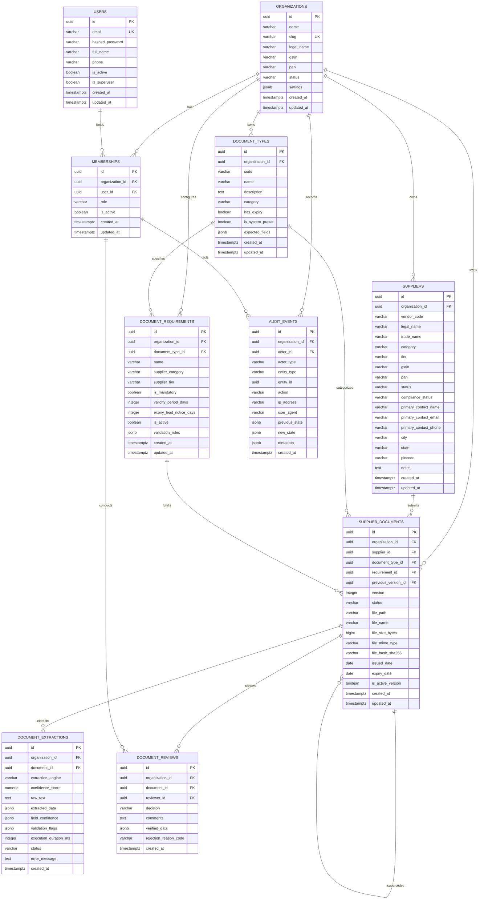

# VendorFlow AI: Database Architecture & Schema Design

## 1. Overview & System Context

VendorFlow AI is a B2B SaaS platform designed for Indian manufacturing enterprises to streamline supplier onboarding, document collection, automated AI/OCR extraction and cross-validation, compliance tracking, and auditable approvals.

This document specifies the PostgreSQL 17 relational database architecture, multi-tenant isolation strategy, table definitions, indexing scheme, and Alembic migration plan.

---

## 2. Multi-Tenant Architectural Decision: Option A vs Option B

A foundational design question for VendorFlow AI is whether supplier records should be tenant-scoped or globally shared.

### Comparison

| Evaluation Dimension | Option A: Tenant-Scoped Supplier Records (Selected) | Option B: Shared Global Supplier Identity (Rejected) |
| :--- | :--- | :--- |
| **Data Ownership & Isolation** | **Total isolation**: Each buyer owns their supplier records. Zero risk of cross-tenant leakage. | **Shared ownership**: Supplier is a global record; relationships are mapped via join tables. |
| **Confidentiality & Privacy** | **Strict**: No buyer can deduce which other manufacturing buyers use a given supplier. | **Vulnerable**: Competitor supplier overlap or volume patterns can leak across buyer boundaries. |
| **Buyer-Specific Customization** | **Native**: Each buyer assigns internal vendor codes (ERP IDs), custom tiers, payment terms, and categories. | **Complex**: Custom vendor codes, tiers, and notes require separate buyer-override join tables. |
| **Document Confidentiality** | **Natural**: Supplier documents (bilateral bank mandates, NDAs, custom quality audits) are strictly buyer-scoped. | **High Risk**: Risk of cross-buyer document exposure if permissions or tagging fail. |
| **Indian Manufacturing Reality** | Reflects industry practice: Auto OEMs and tier-1 manufacturers require strictly bilateral compliance files. | Premature: Indian suppliers will not consent to open cross-buyer visibility without complex consent frameworks. |
| **Implementation Complexity** | **Low to Moderate**: Clean foreign keys, standard tenant scoping, simple authorization. | **Very High**: Federated permissions, dispute resolution, multi-party data governance. |

### Architectural Recommendation for MVP

**Option A (Tenant-Scoped Supplier Records)** is selected:
1. **Unassailable Tenant Isolation**: In compliance and regulatory auditing, data contamination between buyers is unacceptable. Option A guarantees that every supplier record, document, and review is permanently bounded by `organization_id`.
2. **Bilateral Indian Business Workflows**: Compliance documents in Indian manufacturing are rarely universal. Bank mandates, supplier code of conduct agreements, and audited balance sheets are provided to a specific buyer. A shared identity provides no practical shortcut for these requirements.
3. **Future Extensibility**: Option A does not prevent a future "Supplier Portal Network". In later phases, a verified supplier can be given a consent-driven export mechanism to clone/prefill standard documents (GSTIN/MSME) across buyers, while maintaining independent tenant-scoped compliance records.

---

## 3. Entity-Relationship Diagram (ERD)



---

## 4. Table-by-Table Definitions & Specifications

### 4.1 Organization & Identity Domain

#### Table: `organizations`
- **Purpose**: Root tenant representing a manufacturing company (buyer).
- **Columns**:
  - `id`: `UUID` PRIMARY KEY DEFAULT `gen_random_uuid()`
  - `name`: `VARCHAR(255)` NOT NULL (Display/commercial name)
  - `slug`: `VARCHAR(100)` NOT NULL UNIQUE (URL-safe slug for workspace routing; automatically indexed by unique constraint)
  - `legal_name`: `VARCHAR(255)` NULL (Registered legal entity name)
  - `gstin`: `VARCHAR(15)` NULL (15-character statutory GST identification number)
  - `pan`: `VARCHAR(10)` NULL (10-character Permanent Account Number)
  - `status`: `VARCHAR(50)` NOT NULL DEFAULT `'active'` (`active`, `suspended`, `archived`)
  - `settings`: `JSONB` NOT NULL DEFAULT `'{}'::jsonb` (Notification preferences, approval rules)
  - `created_at`: `TIMESTAMPTZ` NOT NULL DEFAULT `NOW()`
  - `updated_at`: `TIMESTAMPTZ` NOT NULL DEFAULT `NOW()` (Maintained via trigger and ORM)
- **Constraints**:
  - `chk_organizations_status`: `CHECK (status IN ('active', 'suspended', 'archived'))`
  - `chk_organizations_gstin`: `CHECK (gstin IS NULL OR gstin ~ '^[0-9]{2}[A-Z]{5}[0-9]{4}[A-Z]{1}[1-9A-Z]{1}Z[0-9A-Z]{1}$')`
  - `chk_organizations_pan`: `CHECK (pan IS NULL OR pan ~ '^[A-Z]{5}[0-9]{4}[A-Z]{1}$')`
- **Indexes**:
  - `idx_organizations_status`: `(status)`

#### Table: `users`
- **Purpose**: Global user identities. Users authenticate globally and access organizations via memberships.
- **Columns**:
  - `id`: `UUID` PRIMARY KEY DEFAULT `gen_random_uuid()`
  - `email`: `VARCHAR(255)` NOT NULL UNIQUE (Stored lowercase; automatically indexed by unique constraint)
  - `hashed_password`: `VARCHAR(255)` NOT NULL
  - `full_name`: `VARCHAR(255)` NOT NULL
  - `phone`: `VARCHAR(20)` NULL
  - `is_active`: `BOOLEAN` NOT NULL DEFAULT `TRUE`
  - `is_superuser`: `BOOLEAN` NOT NULL DEFAULT `FALSE`
  - `created_at`: `TIMESTAMPTZ` NOT NULL DEFAULT `NOW()`
  - `updated_at`: `TIMESTAMPTZ` NOT NULL DEFAULT `NOW()` (Maintained via trigger and ORM)
- **Constraints**:
  - `chk_users_email_lowercase`: `CHECK (email = lower(email))`
- **Indexes**:
  - Implicit unique index on `email` (`users_email_key`).

#### Table: `memberships`
- **Purpose**: Scopes users to organizations with specific role-based permissions and establishes membership integrity for reviews and audit trails.
- **Columns**:
  - `id`: `UUID` PRIMARY KEY DEFAULT `gen_random_uuid()`
  - `organization_id`: `UUID` NOT NULL REFERENCES `organizations(id)` ON DELETE RESTRICT
  - `user_id`: `UUID` NOT NULL REFERENCES `users(id)` ON DELETE RESTRICT
  - `role`: `VARCHAR(50)` NOT NULL DEFAULT `'reviewer'` (`owner`, `admin`, `reviewer`, `viewer`)
  - `is_active`: `BOOLEAN` NOT NULL DEFAULT `TRUE`
  - `created_at`: `TIMESTAMPTZ` NOT NULL DEFAULT `NOW()`
  - `updated_at`: `TIMESTAMPTZ` NOT NULL DEFAULT `NOW()`
- **Constraints**:
  - `uq_memberships_user_org`: UNIQUE (`user_id`, `organization_id`) — Enforces single membership per user per tenant and provides the target unique key for composite foreign keys from `document_reviews` and `audit_events`. Redundant `(organization_id, user_id)` constraint is removed.
  - `chk_memberships_role`: `CHECK (role IN ('owner', 'admin', 'reviewer', 'viewer'))`
- **Indexes**:
  - `idx_memberships_org_role`: `(organization_id, role)` — Non-unique organization-first index supporting tenant member listing and role filtering.

---

### 4.2 Supplier Management Domain

#### Table: `suppliers`
- **Purpose**: Tenant-scoped supplier profile and onboarding record.
- **Columns**:
  - `id`: `UUID` PRIMARY KEY DEFAULT `gen_random_uuid()`
  - `organization_id`: `UUID` NOT NULL REFERENCES `organizations(id)` ON DELETE RESTRICT
  - `vendor_code`: `VARCHAR(50)` NULL (Buyer ERP vendor ID, e.g. "V-00892")
  - `legal_name`: `VARCHAR(255)` NOT NULL
  - `trade_name`: `VARCHAR(255)` NULL (DBA / commercial brand name)
  - `category`: `VARCHAR(100)` NOT NULL DEFAULT `'raw_materials'` (`raw_materials`, `machined_components`, `electrical`, `tooling`, `mro`, `services`, `packaging`)
  - `tier`: `VARCHAR(20)` NOT NULL DEFAULT `'tier_2'` (`tier_1`, `tier_2`, `tier_3`)
  - `gstin`: `VARCHAR(15)` NULL
  - `pan`: `VARCHAR(10)` NULL
  - `status`: `VARCHAR(50)` NOT NULL DEFAULT `'draft'` (`draft`, `invited`, `onboarding`, `under_review`, `approved`, `rejected`, `archived`)
  - `compliance_status`: `VARCHAR(50)` NOT NULL DEFAULT `'pending'` (`compliant`, `pending`, `action_required`, `non_compliant`, `expired`)
  - `primary_contact_name`: `VARCHAR(255)` NULL
  - `primary_contact_email`: `VARCHAR(255)` NULL
  - `primary_contact_phone`: `VARCHAR(20)` NULL
  - `city`: `VARCHAR(100)` NULL
  - `state`: `VARCHAR(100)` NULL
  - `pincode`: `VARCHAR(10)` NULL
  - `notes`: `TEXT` NULL
  - `created_at`: `TIMESTAMPTZ` NOT NULL DEFAULT `NOW()`
  - `updated_at`: `TIMESTAMPTZ` NOT NULL DEFAULT `NOW()`
- **Constraints**:
  - `uq_suppliers_id_org`: UNIQUE (`id`, `organization_id`) (enables composite foreign key integrity)
  - `uq_suppliers_org_vendor_code`: UNIQUE (`organization_id`, `vendor_code`) — Standard SQL UNIQUE: allows multiple incomplete records with NULL vendor code; enforces uniqueness once populated.
  - `uq_suppliers_org_gstin`: UNIQUE (`organization_id`, `gstin`) — Standard SQL UNIQUE: allows multiple incomplete records with NULL GSTIN; enforces uniqueness once populated.
  - `chk_suppliers_status`: `CHECK (status IN ('draft', 'invited', 'onboarding', 'under_review', 'approved', 'rejected', 'archived'))`
  - `chk_suppliers_compliance`: `CHECK (compliance_status IN ('compliant', 'pending', 'action_required', 'non_compliant', 'expired'))`
  - `chk_suppliers_tier`: `CHECK (tier IN ('tier_1', 'tier_2', 'tier_3'))`
  - `chk_suppliers_gstin_format`: `CHECK (gstin IS NULL OR gstin ~ '^[0-9]{2}[A-Z]{5}[0-9]{4}[A-Z]{1}[1-9A-Z]{1}Z[0-9A-Z]{1}$')`
  - `chk_suppliers_pan_format`: `CHECK (pan IS NULL OR pan ~ '^[A-Z]{5}[0-9]{4}[A-Z]{1}$')`
- **Indexes**:
  - `idx_suppliers_org_status`: `(organization_id, status)`
  - `idx_suppliers_org_compliance`: `(organization_id, compliance_status)`
  - `idx_suppliers_org_legal_name`: `(organization_id, legal_name)`
- **Operational & Lifecycle Notes**:
  - **Tenant-Scoped Uniqueness**: Uniqueness on `vendor_code` and `gstin` is strictly scoped to `organization_id` via composite unique constraints (`uq_suppliers_org_vendor_code`, `uq_suppliers_org_gstin`). Two independent buyer tenants can onboard the same legal entity (sharing GSTIN) or assign the same internal code without collision. Multiple incomplete supplier records with `NULL` `vendor_code` or `gstin` are permitted per standard SQL `UNIQUE` semantics.
  - **Soft-Archival & Immutability**: Suppliers are never hard-deleted (`ON DELETE RESTRICT` protects foreign references). Archival transitions `status` to `'archived'`. Archived records are permanently retained for regulatory inspection (Companies Act 2013 / CGST Act 2017). Modifying an archived supplier or re-archiving is blocked at the domain service layer.
  - **Transactional Audit Logging**: Every supplier creation, modification, and archival atomically inserts an audit event into `audit_events` (`supplier.created`, `supplier.updated`, `supplier.archived`) in the same database transaction, capturing `previous_state` and `new_state` diffs.

---

### 4.3 Document Requirements Domain

#### Table: `document_types`
- **Purpose**: Tenant-owned catalog of document types. System presets (`gst_certificate`, `pan_card`, `msme_udyam`, `bank_mandate`, `iso_9001`, `factory_license`) are initialized as tenant-owned copies upon organization creation.
- **Columns**:
  - `id`: `UUID` PRIMARY KEY DEFAULT `gen_random_uuid()`
  - `organization_id`: `UUID` NOT NULL REFERENCES `organizations(id)` ON DELETE RESTRICT
  - `code`: `VARCHAR(50)` NOT NULL (`gst_certificate`, `pan_card`, `msme_udyam`, `bank_mandate`, `iso_9001`, `factory_license`, etc.)
  - `name`: `VARCHAR(255)` NOT NULL
  - `description`: `TEXT` NULL
  - `category`: `VARCHAR(50)` NOT NULL DEFAULT `'statutory'` (`statutory`, `tax`, `quality`, `financial`, `legal`, `safety`)
  - `has_expiry`: `BOOLEAN` NOT NULL DEFAULT `FALSE`
  - `is_system_preset`: `BOOLEAN` NOT NULL DEFAULT `FALSE` (True if initialized from standard system presets)
  - `expected_fields`: `JSONB` NOT NULL DEFAULT `'[]'::jsonb` (e.g. `["gstin", "legal_name", "date_of_registration"]`)
  - `created_at`: `TIMESTAMPTZ` NOT NULL DEFAULT `NOW()`
  - `updated_at`: `TIMESTAMPTZ` NOT NULL DEFAULT `NOW()`
- **Constraints**:
  - `uq_document_types_id_org`: UNIQUE (`id`, `organization_id`) (enables composite foreign keys)
  - `uq_document_types_org_code`: UNIQUE (`organization_id`, `code`)
  - `chk_document_types_category`: `CHECK (category IN ('statutory', 'tax', 'quality', 'financial', 'legal', 'safety'))`
- **Indexes**:
  - Implicit unique index from `uq_document_types_org_code` handles `(organization_id, code)` lookups.

#### Table: `document_requirements`
- **Purpose**: Organization compliance policy defining which document types are mandatory for which supplier categories and tiers.
- **Columns**:
  - `id`: `UUID` PRIMARY KEY DEFAULT `gen_random_uuid()`
  - `organization_id`: `UUID` NOT NULL REFERENCES `organizations(id)` ON DELETE RESTRICT
  - `document_type_id`: `UUID` NOT NULL
  - `name`: `VARCHAR(255)` NOT NULL (Policy display name, e.g. "Tier 1 Components Statutory Pack")
  - `supplier_category`: `VARCHAR(100)` NULL (NULL = applies to all categories)
  - `supplier_tier`: `VARCHAR(20)` NULL (NULL = applies to all tiers)
  - `is_mandatory`: `BOOLEAN` NOT NULL DEFAULT `TRUE`
  - `validity_period_days`: `INTEGER` NULL (Default period of validity)
  - `expiry_lead_notice_days`: `INTEGER` NOT NULL DEFAULT `30` (Lead days prior to expiry to trigger renewal notice)
  - `is_active`: `BOOLEAN` NOT NULL DEFAULT `TRUE`
  - `validation_rules`: `JSONB` NOT NULL DEFAULT `'{}'::jsonb` (Rule configuration for automated validation)
  - `created_at`: `TIMESTAMPTZ` NOT NULL DEFAULT `NOW()`
  - `updated_at`: `TIMESTAMPTZ` NOT NULL DEFAULT `NOW()`
- **Constraints**:
  - `uq_doc_requirements_id_org`: UNIQUE (`id`, `organization_id`)
  - `uq_doc_requirements_id_type_org`: UNIQUE (`id`, `document_type_id`, `organization_id`) — Target unique key for composite foreign key from `supplier_documents`.
  - `fk_doc_requirements_doc_type`: FOREIGN KEY (`document_type_id`, `organization_id`) REFERENCES `document_types(id`, `organization_id`) ON DELETE RESTRICT
  - `chk_doc_requirements_expiry_lead`: `CHECK (expiry_lead_notice_days >= 0)`
  - `chk_doc_requirements_validity`: `CHECK (validity_period_days IS NULL OR validity_period_days > 0)`
- **Indexes**:
  - `idx_doc_requirements_org_active`: `(organization_id, is_active)`
  - `idx_doc_requirements_lookup`: `(organization_id, supplier_category, supplier_tier)`
- **Operational & Evaluation Notes**:
  - **Tenant Boundary Guarantee**: Composite foreign key `fk_doc_requirements_doc_type` structurally ensures requirements only bind to document types within the same tenant. The service layer validates this prior to SQL execution (`400 Bad Request`).
  - **Duplicate Prevention**: The business layer enforces uniqueness on `(organization_id, document_type_id, supplier_category, supplier_tier)` (`409 Conflict`) to avoid ambiguous requirement policies.
  - **Supplier Evaluation**: The evaluation engine matches a supplier's `(category, tier)` against active requirements (`is_active = TRUE`), excluding disabled requirements and partitioning results into `mandatory_requirements` and `optional_requirements`.
  - **Audit Integration**: Mutations atomically generate records in `audit_events` (`document_requirement.created`, `document_requirement.updated`, `document_requirement.enabled`, `document_requirement.disabled`).

---

### 4.4 Document Management & Extraction Domain

#### Table: `supplier_documents`
- **Purpose**: Uploaded document files and revision lifecycle states. Stores file metadata and local filesystem storage path (never binary blobs).
- **Columns**:
  - `id`: `UUID` PRIMARY KEY DEFAULT `gen_random_uuid()`
  - `organization_id`: `UUID` NOT NULL REFERENCES `organizations(id)` ON DELETE RESTRICT
  - `supplier_id`: `UUID` NOT NULL
  - `document_type_id`: `UUID` NOT NULL
  - `requirement_id`: `UUID` NULL
  - `previous_version_id`: `UUID` NULL
  - `version`: `INTEGER` NOT NULL DEFAULT `1`
  - `status`: `VARCHAR(50)` NOT NULL DEFAULT `'uploaded'` (`uploaded`, `processing`, `extracted`, `verified`, `rejected`, `action_required`, `expired`, `superseded`)
  - `file_path`: `VARCHAR(512)` NOT NULL (Relative local storage path under `storage/documents/<org_id>/...`)
  - `file_name`: `VARCHAR(255)` NOT NULL (Original uploaded filename)
  - `file_size_bytes`: `BIGINT` NOT NULL
  - `file_mime_type`: `VARCHAR(100)` NOT NULL (`application/pdf`, `image/jpeg`, `image/png`)
  - `file_hash_sha256`: `VARCHAR(64)` NOT NULL (Cryptographic SHA-256 for integrity verification and duplicate detection)
  - `issued_date`: `DATE` NULL
  - `expiry_date`: `DATE` NULL
  - `is_active_version`: `BOOLEAN` NOT NULL DEFAULT `TRUE`
  - `created_at`: `TIMESTAMPTZ` NOT NULL DEFAULT `NOW()`
  - `updated_at`: `TIMESTAMPTZ` NOT NULL DEFAULT `NOW()`
- **Constraints**:
  - `uq_supplier_documents_id_org`: UNIQUE (`id`, `organization_id`)
  - `fk_supplier_documents_supplier`: FOREIGN KEY (`supplier_id`, `organization_id`) REFERENCES `suppliers(id`, `organization_id`) ON DELETE RESTRICT
  - `fk_supplier_documents_doc_type`: FOREIGN KEY (`document_type_id`, `organization_id`) REFERENCES `document_types(id`, `organization_id`) ON DELETE RESTRICT
  - `fk_supplier_documents_requirement`: FOREIGN KEY (`requirement_id`, `document_type_id`, `organization_id`) REFERENCES `document_requirements(id`, `document_type_id`, `organization_id`) ON DELETE RESTRICT
  - `fk_supplier_documents_previous_version`: FOREIGN KEY (`previous_version_id`, `organization_id`) REFERENCES `supplier_documents(id`, `organization_id`) ON DELETE RESTRICT
  - `uq_supplier_documents_version`: UNIQUE (`supplier_id`, `document_type_id`, `version`)
  - `chk_supplier_docs_version`: `CHECK (version >= 1)`
  - `chk_supplier_docs_file_size`: `CHECK (file_size_bytes > 0 AND file_size_bytes <= 26214400)` (Max 25 MB per document)
  - `chk_supplier_docs_hash_format`: `CHECK (file_hash_sha256 ~ '^[a-f0-9]{64}$')`
  - `chk_supplier_docs_mime_type`: `CHECK (file_mime_type IN ('application/pdf', 'image/jpeg', 'image/png'))`
  - `chk_supplier_docs_status`: `CHECK (status IN ('uploaded', 'processing', 'extracted', 'verified', 'rejected', 'action_required', 'expired', 'superseded'))`
- **Indexes**:
  - `uq_supplier_docs_active_version`: UNIQUE (`supplier_id`, `document_type_id`) WHERE (`is_active_version` = TRUE)
  - `idx_supplier_docs_expiry`: (`organization_id`, `expiry_date`) WHERE (`is_active_version` = TRUE AND `expiry_date` IS NOT NULL)
  - `idx_supplier_docs_supplier`: (`organization_id`, `supplier_id`, `is_active_version`)
  - `idx_supplier_docs_org_hash`: (`organization_id`, `file_hash_sha256`)

##### Document Lifecycle & Review Transition Semantics:
- **Decision vs Status Separation**: `document_reviews.decision` (`approved`, `rejected`, `revision_requested`) remains distinct from `supplier_documents.status`:
  - `approved` review decision -> transitions active document status to `verified`.
  - `rejected` review decision -> transitions active document status to `rejected`.
  - `revision_requested` review decision -> transitions active document status to `action_required`.
- **Version Preservation**: Historical document records and their associated `document_reviews` and `document_extractions` are permanently retained. A superseded or deactivated document is marked `is_active_version = FALSE`, while retaining its historical terminal status (`verified`, `rejected`, or `action_required`).
- **Application-Level Expiry & Compliance Evaluation**: A document is NOT automatically deactivated merely because its `expiry_date` is in the past. Date calculations and compliance status derivations belong strictly to the application-level compliance calculation service or scheduled background tasks, avoiding database-level date mutations.

##### Nullable `requirement_id` Behaviour:
Under PostgreSQL's default `MATCH SIMPLE` foreign key semantics, when `requirement_id` is NULL (e.g. for ad-hoc or unmapped supplier document uploads), the composite constraint `(requirement_id, document_type_id, organization_id)` is satisfied without requiring a matching row in `document_requirements`. When `requirement_id` is non-null, all three columns must strictly match `document_requirements(id, document_type_id, organization_id)`. This structurally prevents a document of type A from ever pointing to a requirement of type B.

#### Table: `document_extractions`
- **Purpose**: Stores OCR / AI data extraction outputs, engine version, and field-level confidence ratings. Kept distinct from human-verified truth.
- **Columns**:
  - `id`: `UUID` PRIMARY KEY DEFAULT `gen_random_uuid()`
  - `organization_id`: `UUID` NOT NULL REFERENCES `organizations(id)` ON DELETE RESTRICT
  - `document_id`: `UUID` NOT NULL
  - `extraction_engine`: `VARCHAR(50)` NOT NULL DEFAULT `'local_ocr'` (e.g. `tesseract`, `easyocr`, `vision_pipeline`)
  - `confidence_score`: `NUMERIC(4, 3)` NULL (Overall confidence 0.000 to 1.000)
  - `raw_text`: `TEXT` NULL (Full unformatted OCR transcript; treated as confidential supplier data)
  - `extracted_data`: `JSONB` NOT NULL DEFAULT `'{}'::jsonb` (Extracted key-value pairs, e.g. `{"gstin": "27AAACP...", "legal_name": "..."}`)
  - `field_confidence`: `JSONB` NOT NULL DEFAULT `'{}'::jsonb` (Field-level confidence mapping)
  - `validation_flags`: `JSONB` NOT NULL DEFAULT `'{}'::jsonb` (Automated cross-document consistency checks)
  - `execution_duration_ms`: `INTEGER` NULL
  - `status`: `VARCHAR(50)` NOT NULL DEFAULT `'pending'` (`pending`, `completed`, `failed`)
  - `error_message`: `TEXT` NULL
  - `created_at`: `TIMESTAMPTZ` NOT NULL DEFAULT `NOW()`
- **Constraints**:
  - `fk_doc_extractions_doc`: FOREIGN KEY (`document_id`, `organization_id`) REFERENCES `supplier_documents(id`, `organization_id`) ON DELETE RESTRICT
  - `chk_doc_extractions_status`: `CHECK (status IN ('pending', 'completed', 'failed'))`
  - `chk_doc_extractions_confidence`: `CHECK (confidence_score IS NULL OR (confidence_score >= 0.000 AND confidence_score <= 1.000))`
- **Indexes**:
  - `idx_doc_extractions_doc`: (`organization_id`, `document_id`)

---

### 4.5 Review & Approval Domain

#### Table: `document_reviews`
- **Purpose**: Review decisions, reviewer comments, and human-verified field overrides.
- **Columns**:
  - `id`: `UUID` PRIMARY KEY DEFAULT `gen_random_uuid()`
  - `organization_id`: `UUID` NOT NULL REFERENCES `organizations(id)` ON DELETE RESTRICT
  - `document_id`: `UUID` NOT NULL
  - `reviewer_id`: `UUID` NOT NULL
  - `decision`: `VARCHAR(50)` NOT NULL (`approved`, `rejected`, `revision_requested`)
  - `comments`: `TEXT` NULL
  - `verified_data`: `JSONB` NOT NULL DEFAULT `'{}'::jsonb` (Human-confirmed/corrected field values)
  - `rejection_reason_code`: `VARCHAR(50)` NULL (`illegible`, `mismatched_gstin`, `expired`, `name_mismatch`, `incomplete_pages`, `invalid_document_type`, `other`)
  - `created_at`: `TIMESTAMPTZ` NOT NULL DEFAULT `NOW()`
- **Constraints**:
  - `fk_doc_reviews_doc`: FOREIGN KEY (`document_id`, `organization_id`) REFERENCES `supplier_documents(id`, `organization_id`) ON DELETE RESTRICT
  - `fk_doc_reviews_reviewer_membership`: FOREIGN KEY (`reviewer_id`, `organization_id`) REFERENCES `memberships(user_id`, `organization_id`) ON DELETE RESTRICT
  - `chk_doc_reviews_decision`: `CHECK (decision IN ('approved', 'rejected', 'revision_requested'))`
  - `chk_doc_reviews_rejection_code`: `CHECK (rejection_reason_code IS NULL OR rejection_reason_code IN ('illegible', 'mismatched_gstin', 'expired', 'name_mismatch', 'incomplete_pages', 'invalid_document_type', 'other'))`
- **Indexes**:
  - `idx_doc_reviews_doc`: (`organization_id`, `document_id`)
  - `idx_doc_reviews_created`: (`organization_id`, `created_at` DESC)
  - `idx_doc_reviews_reviewer`: (`reviewer_id`)

##### Reviewer Identification Evaluation:
`reviewer_id` referencing `memberships(user_id, organization_id)` is chosen over `reviewer_membership_id` referencing `memberships(id, organization_id)`:
1. **Consistency**: Both `audit_events(actor_id, organization_id)` and `document_reviews(reviewer_id, organization_id)` follow the identical referential shape.
2. **Key Economy**: Enables a single unique constraint `memberships(user_id, organization_id)` to serve as the target for both composite foreign keys.
3. **Application Ergonomics**: The user's authenticated principal ID (`current_user.id`) directly populates `reviewer_id` and `actor_id` without requiring an additional membership-ID resolution query.

---

### 4.6 Auditing Domain

#### Table: `audit_events`
- **Purpose**: Append-only event log capturing every statutory and operational event.
- **Columns**:
  - `id`: `UUID` PRIMARY KEY DEFAULT `gen_random_uuid()`
  - `organization_id`: `UUID` NOT NULL REFERENCES `organizations(id)` ON DELETE RESTRICT
  - `actor_id`: `UUID` NULL
  - `actor_type`: `VARCHAR(50)` NOT NULL DEFAULT `'user'` (`user`, `supplier`, `system`)
  - `entity_type`: `VARCHAR(50)` NOT NULL (`supplier`, `document`, `requirement`, `review`, `organization`, `membership`, `document_type`)
  - `entity_id`: `UUID` NOT NULL (Polymorphic entity reference; referential validity validated at application layer)
  - `action`: `VARCHAR(100)` NOT NULL (e.g. `supplier.created`, `document.uploaded`, `document.extracted`, `document.approved`, `document.rejected`, `document.expired`, `organization.archived`)
  - `ip_address`: `VARCHAR(45)` NULL (IPv4 / IPv6)
  - `user_agent`: `VARCHAR(255)` NULL
  - `previous_state`: `JSONB` NULL (State prior to action)
  - `new_state`: `JSONB` NULL (State resulting from action)
  - `metadata`: `JSONB` NOT NULL DEFAULT `'{}'::jsonb`
  - `created_at`: `TIMESTAMPTZ` NOT NULL DEFAULT `NOW()`
- **Constraints**:
  - `fk_audit_events_actor_membership`: FOREIGN KEY (`actor_id`, `organization_id`) REFERENCES `memberships(user_id`, `organization_id`) ON DELETE RESTRICT
  - `chk_audit_events_actor_type`: `CHECK (actor_type IN ('user', 'supplier', 'system'))`
  - `chk_audit_events_actor_attribution`: `CHECK ((actor_type = 'user' AND actor_id IS NOT NULL) OR (actor_type IN ('supplier', 'system') AND actor_id IS NULL))`
- **Indexes**:
  - `idx_audit_events_timeline`: (`organization_id`, `created_at` DESC)
  - `idx_audit_events_entity`: (`organization_id`, `entity_type`, `entity_id`)

---

## 5. Composite Foreign Key Architecture & Referential Integrity

To provide structural defense-in-depth against cross-tenant data corruption, every tenant-owned child table enforces composite foreign keys spanning both the parent entity ID and `organization_id`:

```
┌─────────────────────────────────────────────────────────────────────────────┐
│                             organizations                                   │
└───────────────┬─────────────────────────────────────────────────────────────┘
                │
                ├──────────────────────────────────────┐
                ▼                                      ▼
┌──────────────────────────────┐       ┌──────────────────────────────┐
│       memberships            │       │       document_types         │
│  UQ: (user_id, org_id)       │       │  UQ: (id, org_id)            │
└───────────────┬──────────────┘       └───────────────┬──────────────┘
                │                                      │
                │                                      ├──────────────────────┐
                │                                      ▼                      ▼
┌───────────────┴──────────────┐       ┌──────────────────────────────┐       │
│         suppliers            │       │    document_requirements     │       │
│  UQ: (id, org_id)            │       │  UQ: (id, org_id)            │       │
└───────────────┬──────────────┘       │  UQ: (id, type_id, org_id)   │       │
                │                      │  FK: (doc_type_id, org_id)   │       │
                │                      └───────────────┬──────────────┘       │
                │                                      │                      │
                └──────────────────────┬───────────────┘                      │
                                       ▼                                      │
                       ┌──────────────────────────────┐                       │
                       │     supplier_documents       │◄──────────────────────┘
                       │  UQ: (id, org_id)            │
                       │  FK: (supplier_id, org_id)   │
                       │  FK: (req_id, type_id, org_id│
                       │  FK: (doc_type_id, org_id)   │
                       │  FK: (prev_ver_id, org_id)───┼──┐ (version lineage)
                       └───────────────┬──────────────┘  │
                                       │◄────────────────┘
                ┌──────────────────────┴──────────────────────┐
                ▼                                             ▼
┌──────────────────────────────┐              ┌──────────────────────────────┐
│     document_extractions     │              │       document_reviews       │
│  FK: (document_id, org_id)   │              │  FK: (document_id, org_id)   │
│                              │              │  FK: (reviewer_id, org_id)───┼──┐
└──────────────────────────────┘              └──────────────────────────────┘  │
                                                                                │
┌──────────────────────────────┐                                                │
│         audit_events         │                                                │
│  FK: (actor_id, org_id)──────┼────────────────────────────────────────────────┘
└──────────────────────────────┘  (Enforces actor/reviewer holds a membership
                                   existence record in the tenant organization)
```

### Complete Composite Foreign Key Mapping

| Child Table | Foreign Key Columns | Target Table & Columns | Deletion Action | Purpose |
| :--- | :--- | :--- | :--- | :--- |
| `document_requirements` | `(document_type_id, organization_id)` | `document_types(id, organization_id)` | `ON DELETE RESTRICT` | Prevents referencing another tenant's document type. |
| `supplier_documents` | `(supplier_id, organization_id)` | `suppliers(id, organization_id)` | `ON DELETE RESTRICT` | Prevents attaching documents to a different tenant's supplier. |
| `supplier_documents` | `(document_type_id, organization_id)` | `document_types(id, organization_id)` | `ON DELETE RESTRICT` | Enforces document type tenant ownership. |
| `supplier_documents` | `(requirement_id, document_type_id, organization_id)` | `document_requirements(id, document_type_id, organization_id)` | `ON DELETE RESTRICT` | Enforces requirement ownership AND guarantees requirement type matches document type. |
| `supplier_documents` | `(previous_version_id, organization_id)` | `supplier_documents(id, organization_id)` | `ON DELETE RESTRICT` | Preserves explicit version ancestry chain within tenant. |
| `document_extractions` | `(document_id, organization_id)` | `supplier_documents(id, organization_id)` | `ON DELETE RESTRICT` | Binds extractions strictly to tenant document. |
| `document_reviews` | `(document_id, organization_id)` | `supplier_documents(id, organization_id)` | `ON DELETE RESTRICT` | Binds review decisions strictly to tenant document. |
| `document_reviews` | `(reviewer_id, organization_id)` | `memberships(user_id, organization_id)` | `ON DELETE RESTRICT` | **Membership Integrity**: Enforces reviewer belongs to the organization. |
| `audit_events` | `(actor_id, organization_id)` | `memberships(user_id, organization_id)` | `ON DELETE RESTRICT` | **Actor Integrity**: Enforces internal user actor belongs to the organization. |

---

## 6. Document Versioning, Integrity & Lifecycle

### 6.1 Logical Document Identity & Revisions
For a given supplier, a document represents the fulfillment of a specific statutory or buyer requirement (`document_type_id`). Over time, documents expire, fail review, or are renewed:

1. **Logical Identity for MVP**: `(supplier_id, document_type_id)`.
   - In the MVP, a supplier maintains at most **one active document per document type** (e.g. one active GST registration certificate).
   - This is enforced via the partial unique index:
     ```sql
     CREATE UNIQUE INDEX uq_supplier_docs_active_version
         ON supplier_documents (supplier_id, document_type_id)
         WHERE (is_active_version = TRUE);
     ```
2. **Revision Numbering**: Managed via `version INTEGER NOT NULL DEFAULT 1` with constraint `CHECK (version >= 1)`.
3. **Unique Revision per Supplier**: Enforced by constraint `uq_supplier_documents_version` on `(supplier_id, document_type_id, version)`.
4. **Version Ancestry Linkage**: Each replacement document explicitly points to its predecessor via `previous_version_id`.

### 6.2 Resubmission Lifecycle (Separation of Activity from Outcome)
When a document is rejected or expires and a replacement is submitted:
1. **The prior version's outcome is preserved**:
   - If version 1 was rejected, its `status` remains `'rejected'`.
   - If version 1 expired, its `status` remains `'expired'`.
   - The prior version's outcome is **never overwritten** with `'superseded'`.
2. **Version activity deactivation**:
   - The prior version's `is_active_version` is set to `FALSE`.
3. **New version insertion**:
   - Version 2 is inserted with `version = previous_version + 1`, `is_active_version = TRUE`, `status = 'uploaded'`, and `previous_version_id = <version_1_id>`.
4. **Permanent audit preservation**:
   - Historical `document_extractions` and `document_reviews` remain permanently attached to their original version (`document_id`). Nothing is overwritten.

### 6.3 Review and Verification Transitions
- **Approval (`decision = 'approved'`)**:
  - `supplier_documents.status` transitions to `'verified'`.
  - Human-verified dates (`issued_date`, `expiry_date`) and verified fields from `document_reviews.verified_data` are updated on the active document record.
  - Review outcome does NOT alter historical machine extraction records.
- **Cross-Document Discrepancies**:
  - Automated cross-document checks (e.g. GSTIN mismatch between certificate and supplier profile) populate `document_extractions.validation_flags`.
  - Discrepancies highlight warnings for human reviewers but do NOT automatically hard-block reviewer approval. A human compliance officer retains authority to review and approve (with documented justification).

### 6.4 File Storage Pattern & Upload Lifecycle
- **Filesystem Pathing**: Files are stored under UUID-based paths:
  `storage/documents/<organization_id>/<supplier_id>/<document_id>.<extension>`
  Here, `<document_id>` is the server-generated primary key UUID. User-supplied filenames (`file_name`) are stored purely as metadata.
- **SHA-256 Role**: Used strictly as an **integrity verification and duplicate-detection mechanism**, not as content-addressed storage.
- **Upload Lifecycle**:
  1. **Staging**: Upload stream is buffered to a temporary quarantine directory (`storage/tmp/...`).
  2. **Validation**: Stream is hashed (SHA-256), byte count is validated against bounds (max 25MB), and magic numbers / file signatures are checked (`%PDF-`, `\xFF\xD8\xFF`, `\x89PNG\r\n\x1a\n`) rather than trusting the client-supplied `Content-Type` header.
  3. **Finalization**: Validated file is moved to its permanent path.
  4. **Database Commit**: Record is committed to PostgreSQL in an atomic transaction.
  5. **Failure Cleanup**: If validation fails or the DB transaction aborts, the staged file is immediately unlinked.
  6. **Orphan Reconciliation**: A background maintenance script periodically checks storage vs database records to prune uncommitted orphan files.

---

## 7. Audit Integrity & Permissions Architecture

### 7.1 Honest Audit Posture
A standard relational table is not cryptographically tamper-evident or immutable by default. VendorFlow AI implements a practical defense-in-depth model:

1. **Application-Level Immutability**:
   - The SQLAlchemy models and API service expose **only** `INSERT` and `SELECT` on `audit_events`.
   - No `UPDATE` or `DELETE` endpoints, schemas, or repository queries exist in the codebase.
2. **Database-Level Privilege Separation (Production Architecture)**:
   - The operational application user (`vendorflow_app`) is granted strictly:
     ```sql
     GRANT SELECT, INSERT ON TABLE audit_events TO vendorflow_app;
     REVOKE UPDATE, DELETE, TRUNCATE ON TABLE audit_events FROM vendorflow_app;
     ```
   - Only a dedicated migration role (`vendorflow_admin`) has DDL privileges during deployments.
3. **Actor Attribution & Membership Scoping**:
   - `actor_type = 'user'`: Requires non-null `actor_id` referencing `memberships(user_id, organization_id)`.
   - `actor_type = 'system'`: Background automated tasks (e.g. nightly expiry scanner), with `actor_id = NULL`.
   - `actor_type = 'supplier'`: External supplier uploads via magic links, with `actor_id = NULL` and session context in `metadata`.
4. **Polymorphic Target Validation**:
   - `audit_events.entity_id` is polymorphic (pointing to `suppliers`, `supplier_documents`, etc.). The application service layer must validate that the target entity belongs to `organization_id` prior to inserting the event.

---

## 8. Retention & Archival Policies (Compliance Lifecycle)

Retention requirements vary by record category, governing statute, and contractual obligation. Blanket claims of universal 8-year retention are avoided:

1. **Governing Indian Statutory Requirements**:
   - **Section 128(5) of the Companies Act, 2013**: Requires books of account and related vouchers/papers to be preserved for not less than **eight financial years** immediately preceding a financial year.
   - **Section 36 of the Central Goods and Services Tax (CGST) Act, 2017**: Requires books of account and related records to be maintained until the expiry of **72 months (6 years)** from the due date of furnishing the annual return for the year pertaining to such accounts.
   - **Transient Records**: Non-statutory vendor notes, temporary onboarding drafts, and ephemeral OCR execution transcripts are subject to configurable enterprise retention schedules.
2. **Legal Holds & Validation**:
   - Retention schedules must be configurable by record category and subject to legal hold overrides during disputes.
   - **All automated retention schedules must be reviewed and validated by enterprise legal and tax counsel.**
3. **Prevention of Destructive Cascades**:
   - Foreign keys across compliance tables (`audit_events`, `supplier_documents`, `document_reviews`, `document_extractions`, `suppliers`) use `ON DELETE RESTRICT`.
   - Entities transition across state machines (`active -> suspended -> archived`). Archiving an organization disables access while preserving compliance evidence.

---

## 9. Database Indexing Strategy

Redundant indexes have been removed:
- Single-column indexes on primary keys and unique constraint columns (`organizations.slug`, `users.email`) are omitted because PostgreSQL automatically creates unique B-Tree indexes for them.
- Composite indexes are ordered by filter selectivity first, followed by range/sort columns.

| Table | Index Name | Indexed Columns | Type / Filter | Query Workload |
| :--- | :--- | :--- | :--- | :--- |
| `organizations` | `idx_organizations_status` | `(status)` | B-Tree | Tenant status checks. |
| `memberships` | `idx_memberships_org_role` | `(organization_id, role)` | B-Tree | Tenant role lookups and member listing. |
| `suppliers` | `idx_suppliers_org_status` | `(organization_id, status)` | B-Tree | Filter suppliers by workflow status. |
| `suppliers` | `idx_suppliers_org_compliance` | `(organization_id, compliance_status)` | B-Tree | Filter suppliers by compliance status. |
| `suppliers` | `idx_suppliers_org_legal_name` | `(organization_id, legal_name)` | B-Tree | Search suppliers by name within tenant. |
| `document_requirements` | `idx_doc_requirements_org_active` | `(organization_id, is_active)` | B-Tree | Fetch active compliance policies. |
| `document_requirements` | `idx_doc_requirements_lookup` | `(organization_id, supplier_category, supplier_tier)` | B-Tree | Rule matching for supplier categories. |
| `supplier_documents` | `uq_supplier_docs_active_version` | `(supplier_id, document_type_id)` | Partial Unique `WHERE is_active_version = TRUE` | Enforces single active version. |
| `supplier_documents` | `idx_supplier_docs_expiry` | `(organization_id, expiry_date)` | Partial B-Tree `WHERE is_active_version = TRUE AND expiry_date IS NOT NULL` | Expiry tracking and alerts. |
| `supplier_documents` | `idx_supplier_docs_supplier` | `(organization_id, supplier_id, is_active_version)` | B-Tree | Supplier compliance dashboard view. |
| `supplier_documents` | `idx_supplier_docs_org_hash` | `(organization_id, file_hash_sha256)` | B-Tree | Duplicate document upload detection. |
| `document_extractions` | `idx_doc_extractions_doc` | `(organization_id, document_id)` | B-Tree | Fetch extraction history for document. |
| `document_reviews` | `idx_doc_reviews_doc` | `(organization_id, document_id)` | B-Tree | Fetch review history for document. |
| `document_reviews` | `idx_doc_reviews_created` | `(organization_id, created_at DESC)` | B-Tree | Pending reviewer inbox feed. |
| `document_reviews` | `idx_doc_reviews_reviewer` | `(reviewer_id)` | B-Tree | Reviewer workload audit. |
| `audit_events` | `idx_audit_events_timeline` | `(organization_id, created_at DESC)` | B-Tree | Chronological audit log viewing. |
| `audit_events` | `idx_audit_events_entity` | `(organization_id, entity_type, entity_id)` | B-Tree | Entity-specific audit history. |

---

## 10. Migration Strategy (Alembic + Async SQLAlchemy)

Database migrations will be managed using Alembic integrated into `apps/api`:

```
apps/api/
├── alembic.ini                   # Alembic configuration (points to app.db.base)
└── alembic/
    ├── env.py                    # Configured for asyncio execution via run_sync
    ├── script.py.mako            # Migration template
    └── versions/
        └── 20261105_0001_initial_schema.py
```

### Async Execution Strategy:
- `alembic/env.py` reads database URL from `app.core.config.settings.database_url`.
- Supports test database execution via `-x db=test` or `ALEMBIC_DB=test`, resolving to `settings.get_test_database_url()`.
- Uses `create_async_engine` and `connection.run_sync(do_run_migrations)` to run synchronous Alembic DDL commands across the async connection.
- `target_metadata = Base.metadata` imports all models from `app.db.base` for complete autogeneration support.

---

## 11. PostgreSQL Trigger Architecture (`updated_at`)

To ensure timestamp integrity across all update vectors—including direct raw SQL updates, database maintenance scripts, and ORM operations—PostgreSQL database-level triggers are established on all tables featuring an `updated_at` column.

### Trigger Function: `set_updated_at_column()`
```sql
CREATE OR REPLACE FUNCTION set_updated_at_column()
RETURNS TRIGGER AS $$
BEGIN
    NEW.updated_at = NOW();
    RETURN NEW;
END;
$$ LANGUAGE plpgsql;
```

### Attached Triggers (BEFORE UPDATE):
1. `organizations`: `trg_organizations_updated_at`
2. `users`: `trg_users_updated_at`
3. `memberships`: `trg_memberships_updated_at`
4. `suppliers`: `trg_suppliers_updated_at`
5. `document_types`: `trg_document_types_updated_at`
6. `document_requirements`: `trg_document_requirements_updated_at`
7. `supplier_documents`: `trg_supplier_documents_updated_at`

*Note*: Immutable append-only tables (`document_extractions`, `document_reviews`, `audit_events`) have no `updated_at` column and do not have update triggers.

---

## 12. Test Database Isolation & Safety Architecture

To guarantee that migration testing, integration tests, and test-suite teardown never modify or truncate development or staging databases:
1. **Dedicated Test Database**: All migration validation and pytest execution run exclusively against a dedicated PostgreSQL database named strictly `vendorflow_test`.
2. **Environment Variable Configuration**: `TEST_DATABASE_URL` specifies the connection URL for `vendorflow_test`. Development configuration `POSTGRES_DB=vendorflow` remains untouched.
3. **Strict Safety Guard**: `app.core.config.Settings.get_test_database_url()` parses the URL and explicitly enforces `assert url.database == 'vendorflow_test'`. Any attempt to run tests or test migrations against any other database raises a `RuntimeError` and terminates immediately.
4. **No Silent Fallback**: Tests refuse to fall back to `database_url` if `TEST_DATABASE_URL` is missing.
5. **Transactional Fixture Isolation**: Tests run inside transaction savepoints (`AsyncSession(..., join_transaction_mode="create_savepoint")`), rolling back every test and preventing state pollution.

---

## 13. Production Role Separation & Audit Immutability

Database privileges are partitioned across two distinct database roles for production deployments (provisioned via `infra/scripts/01_provision_roles.sql`):
1. **`vendorflow_admin`**:
   - Schema owner.
   - Owns all tables, types, sequences, and trigger functions.
   - Holds full DDL privileges (`CREATE`, `ALTER`, `DROP`).
   - Used exclusively by deployment pipelines to execute Alembic migrations.
2. **`vendorflow_app`**:
   - Runtime application role used by the FastAPI connection pool.
   - Holds NO DDL privileges and cannot truncate any table.
   - Holds operational DML (`SELECT`, `INSERT`, `UPDATE`, `DELETE`) on standard domain tables.
   - Holds STRICT append-only privileges (`SELECT`, `INSERT`) on `audit_events`. `UPDATE`, `DELETE`, and `TRUNCATE` are explicitly revoked.

### PostgreSQL Owner Bypass Caveat:
In PostgreSQL, the owner of a table and superusers automatically bypass table-level `GRANT` / `REVOKE` checks. Therefore:
- Engine-enforced audit immutability requires that the runtime application connects as a non-owner role (`vendorflow_app`).
- In local development, the single `vendorflow` user functions as database owner and superuser for development ergonomics. As such, audit immutability in local dev is an application-enforced invariant, while engine-level enforcement is activated in staging/production via `vendorflow_app`.

---

## 14. Summary of Rejected Alternatives & Unresolved Decisions

### Rejected Alternatives
1. **Shared Global Supplier Profile (Option B)**:
   - *Rejected*: Poses severe cross-tenant privacy risks and competitor leaks in Indian manufacturing supply chains.
2. **Nullable `organization_id` on Document Types**:
   - *Rejected*: Breaks composite foreign key referential integrity; risks cross-tenant type leakage. Tenant-owned preset copies provide airtight isolation.
3. **Overwriting Outcome with `'superseded'`**:
   - *Rejected*: Erases historical review outcomes. Outcome (`rejected`, `expired`, `verified`) is permanently separated from version activity (`is_active_version`).
4. **`UNIQUE NULLS NOT DISTINCT` on Draft Supplier Fields**:
   - *Rejected*: Blocked inserting multiple draft suppliers with `NULL` vendor code or GSTIN. Standard SQL unique constraints properly allow multiple NULLs while enforcing uniqueness when populated.
5. **PostgreSQL RLS for MVP**:
   - *Rejected*: Risk of session-variable cross-contamination in `asyncpg` connection pool. Composite foreign keys provide deterministic compile-time and runtime safety.

### Unresolved Decisions Requiring Approval
1. **Supplier Upload Authentication**: Confirm whether external suppliers in Phase 3 submit documents via:
   - *Approach A (Recommended)*: Single-use, time-limited cryptographic magic links (zero friction, no supplier account creation required).
   - *Approach B*: Dedicated supplier user portal accounts (requires separate supplier user management).
2. **Multi-Active Documents per Document Type (Post-MVP)**:
   - In MVP, exactly one active document is permitted per `(supplier_id, document_type_id)`. If future enterprise buyers require multiple active certificates for a single document type (e.g. multi-site ISO 9001 certificates or multiple GSTINs across Indian states), the uniqueness scope will be expanded to incorporate `requirement_id` or an explicit site/branch identifier.
3. **Production File Storage Provider**: While local filesystem storage (`storage/documents/`) is used during development, evaluate whether production deployment will use local persistent volume mounts or S3-compatible object storage.
